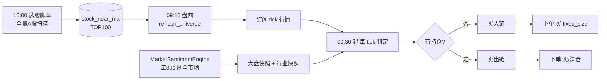
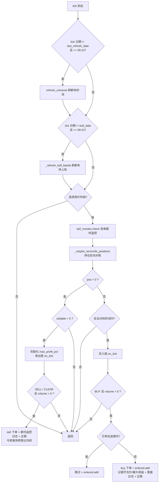
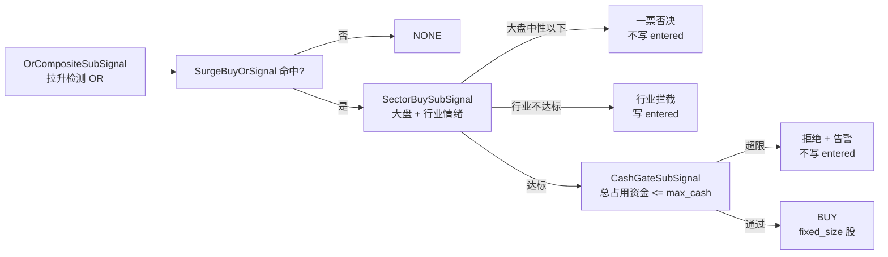
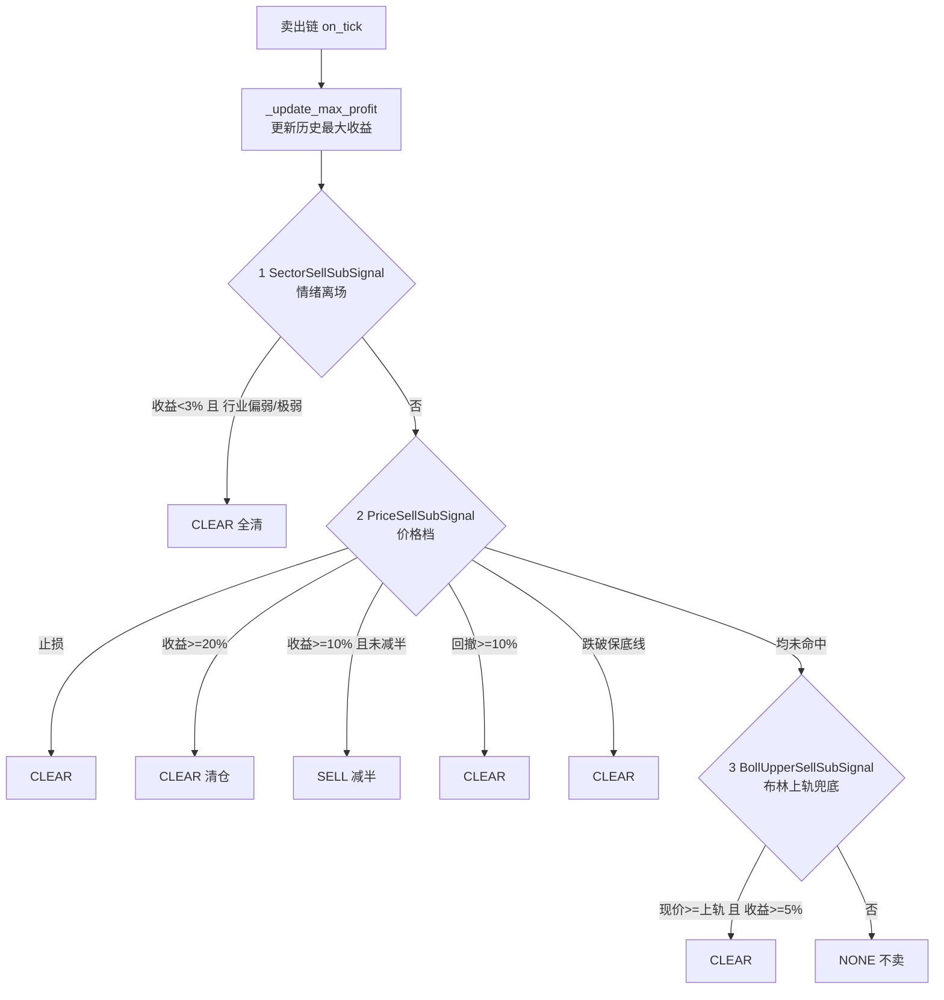
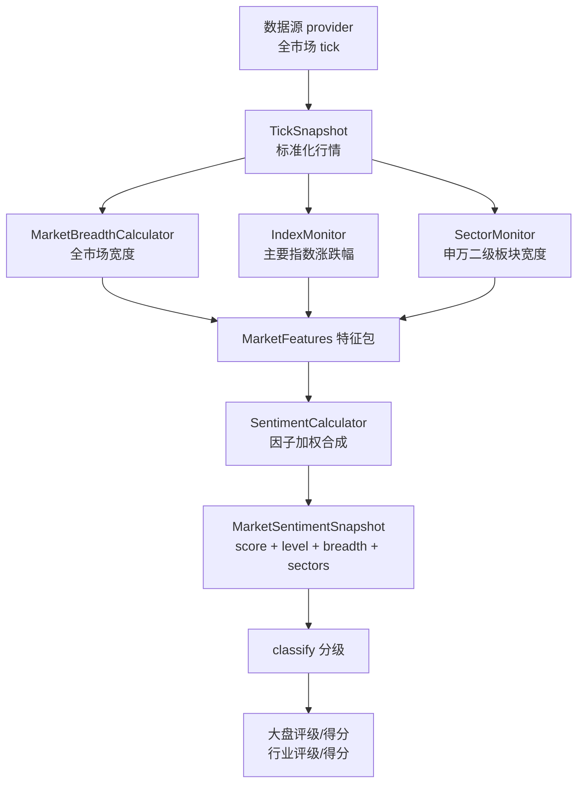

# 近均线快速拉升策略 —— 完整说明

> 策略代码：`vnpy_portfoliostrategy/strategies/near_ma_surge_strategy.py`（类 `NearMaSurgeStrategy`）
> 信号代码：`vnpy_portfoliostrategy/signals/{base,buy_signals,sell_signals,sentiment_signals}.py`
> 选股脚本：`vnpy_scripttrader/script/select_near_ma_all_xtquant.py`（全市场版）与 `select_near_ma_xtquant.py`（行业版）
> 情绪 App：`vnpy_marketsentiment`（`MarketSentimentEngine`）

**一句话概括**：每个交易日收盘后（16:00）用脚本对全量 A 股做一次"贴近历史成本均线 + 已腰斩"的筛选，把得分最高的 100 只落库；次日盘中策略订阅这批标的的 tick，在**无持仓**的标的上用 tick 实时检测"快速拉升"，命中且**市场情绪允许**时买入固定股数；持仓后由**情绪离场 / 分档止损 / 分档止盈 / 回撤 / 保底 / 布林上轨**六类规则决定卖出（其中止损与止盈各分两档，共 **8 个具体档位**）。

> **先明确一个前提：本策略是组合策略**（PortfolioStrategy），**一个策略实例同时管理池内的全部标的**。下文的所有买入 / 卖出判定，除特别说明外都是**针对单个标的**的 —— 每只标的各自独立判定、独立持仓、独立冷却，互不干扰。组合层面只有三件事：**标的池、资金上限、共享的情绪数据**（详见 §1.7）。

---

## 一、策略整体流程

### 1.1 系统组成与数据流

| 组成 | 实现 | 作用 |
|---|---|---|
| 选股脚本 | `select_near_ma_all_xtquant.py`（ScriptTrader 策略） | 每交易日 16:00 扫描全量 A 股，结果写入 SqlApp 的 `stock_near_ma` 表 |
| 选股结果表 | `stock_near_ma`（SqlApp / SQLite 或 MySQL） | 策略盘前按 `sector_name` + `trade_date` 查当日标的池 |
| 行情 | 大 QMT（xtquant）tick 推送，经 `vnpy_xt`（`XtGateway`）进 MainEngine | 策略 `on_tick` 的唯一输入 |
| 情绪 App | `vnpy_marketsentiment` 的 `MarketSentimentEngine`（后台线程自刷新，策略只读快照） | 大盘情绪评级/得分 + 申万二级行业评级/得分 |
| 策略本体 | `NearMaSurgeStrategy`（PortfolioStrategy 引擎） | **一个实例管池内全部标的**：组织标的池、分发 tick、按信号结果下单、持仓与冷却管理 |
| 通用件 | `OrderMonitor`（`order_monitor.py`）、`StrategyContext`（`template.py`） | 卖出委托超时监控、资金/持仓上下文 |

> 部署时实际加载的组件：网关仅 `XtGateway`（`vnpy_xt`）；App 有 `PortfolioStrategyApp`、`SqlApp`、`ScriptTraderApp`（选股脚本靠它跑），以及 `MarketSentimentApp`（市场情绪）—— 后两个通过 Station 的自定义 hook 注册（`vnpy_deploy/.../vnpy_station_custom_hook.py`）。



### 1.2 一个交易日内的时间轴

| 时刻 | 动作 |
|---|---|
| 前一交易日 16:00 | 选股脚本运行，写 `stock_near_ma`（按 `trade_date` = 前一交易日） |
| 09:15（`REFRESH_TIME`） | `refresh_universe()`：按前一交易日取当日池 → 订阅新标的 / 退订"不在池中且无持仓"的旧标的 → 重新发起持仓查询并武装反向对账；紧接着 `_refresh_boll_bands()` 算当日布林上轨 |
| 09:15 ~ 09:30 | **集合竞价**：只刷新标的池，不做买卖判定、不做窗口采样（`_is_trading_session` 返回 False） |
| 09:30（`MARKET_OPEN_TIME`）起 | 连续竞价：每 tick 走完整流程 |
| 15:00 | 收盘，停止 tick |

> 盘中重启不会漏步骤：`boll_date` 是内存标记，重启当天到点后会补算一次布林上轨；`cooldown_dates` 是持久化变量，重启后当天冷却仍生效。

### 1.3 每个 tick 的完整执行顺序（`on_tick`，**按标的**）

**注意：`on_tick` 是按标的回调的** —— 每只标的的行情到达，都会独立走一遍下面这一整套流程。图中所有判断（`pos`、`sellable`、`max_profit_pct` 等）都是**针对当前这只标的**的；只有**日切刷新、卖单超时监控、持仓反向对账**这三步是组合级的（每只标的的 tick 都会触发一次，但内部有日切标记与限频保护，实际只真正执行一次）。



关键点：

- **日切只做一次**：用 `last_refresh_date`（日历当天）标记今日已尝试刷新，避免每 tick 重复查库。
- **卖出优先、买入次之**：有持仓的标的只走卖出分支，`return` 后不再走买入；因此**同一标的不做加仓**。
- **非池内标的不创建买入子信号**：无持仓且不在 `target_symbols` 时直接返回，避免无谓采样与状态残留。

### 1.4 两层信号架构

信号层与策略层职责分离：**信号只表态，策略负责下单与状态**。

- `SubSignal`：单标的子信号，每标的一组独立实例。接口 `on_tick(tick, prev) -> SignalResult` / `on_bar(bar, prev) -> SignalResult`，接收链上前序结果 `prev`，返回自己的产出（可保留 / 否定 / 改写）。所有计算在 `on_tick` 完成，`signal_result()` 只返回缓存（零计算）。
- `SignalAggregator`：总信号，按 `vt_symbol` 维护有序子信号链，`on_tick` 顺序运行并把累计结果逐个传递。
- `SignalResult(type, volume, price, reason)`：`type ∈ {NONE, BUY, SELL, CLEAR}`；`reason` 直接用于日志与企微。

需要**跨日持久化**的状态（开仓价、最大收益、标的池、冷却日）由策略持有并注册到 `variables`；子信号只持有运行时状态（价格窗口等），通过 `self.strategy` 反向访问。

> 注意：买入 / 卖出总信号实例是**全组合共享的一个对象**，但它内部的全部状态（子信号实例、价格窗口样本、结果缓存）都按 `vt_symbol` 隔离 —— 所以"两条链"是**组合级的容器**，链上跑的判定是**单标的的**。下面两条链描述的是"某一只标的"会经过的路径。

- 买入链：`BuyAggregator = [SurgeBuyOrSignal, SectorBuySubSignal, CashGateSubSignal]`
- 卖出链：`SellAggregator = [SellSubSignal]`，`SellSubSignal` 是优先级组合 `[SectorSellSubSignal, PriceSellSubSignal, BollUpperSellSubSignal]`

### 1.5 策略持有的持久化状态

`variables` 中随策略 JSON 落盘的字段（`portfolio_strategy_data.json`）：

| 变量 | 归属 | 含义 |
|---|---|---|
| `target_symbols` | 组合 | 当日标的池 `vt_symbol -> name` |
| `last_refresh_date` | 组合 | 最近一次刷新日期（YYYYMMDD），日切判断用 |
| `surge_count` | 组合 | 累计触发拉升买入次数（全策略计数，不分标的） |
| `entry_prices` | 单标的 | 开仓价（**一轮持仓内不可变**，是全部收益率判定的唯一基准） |
| `max_profit_pct` | 单标的 | 开仓后最大收益率（回撤止盈与保底线的基准） |
| `cooldown_dates` | 单标的 | 买入禁入**截止日** `vt_symbol -> YYYYMMDD` |

仅内存、不落盘的运行时状态：`entered`（本轮已触发买入的**标的集合**，按标的存条目）、`cash_short_count`、`boll_up` / `boll_date`（按标的分开存）、`sell_monitor`、反向对账进度。

### 1.6 几个工程性保障

- **重复下单防护**：`entered` 集合 + `context.has_active_order()` 双重保护；已触发或已有在途委托时不再发买单，保证单标的不超 `fixed_size` 股。
- **卖出委托监控**（`OrderMonitor`）：卖单发出后跟踪；全部成交/撤单/拒单即摘除；挂满 `SELL_ORDER_TIMEOUT`（默认 300s）仍未全部成交则企微告警 + 撤单，**不重发**（撤单释放的 T+1 冻结量让可卖量恢复，条件仍成立时后续 tick 自然重新下单）。监控状态仅存活于进程内。
- **持仓反向对账**（`RECONCILE_BROKER_POSITION`）：QMT 持仓查询只返回有仓的行，完全平掉的标的不会产生 0 仓回报，MainEngine 持仓缓存又"只覆盖不删除"，因此本地可能残留"幽灵仓"。策略在 `on_tick` 中限频自行对账：启动/盘前重同步发出持仓查询 → 宽限期（`RECONCILE_GRACE=15s`）后，每 `RECONCILE_INTERVAL=20s` 比对"本地有、经纪商连续 `RECONCILE_CONFIRM=2` 轮未报"的标的并整体清零 + 企微告警；清零时登记"当日禁买"（外部平仓拿不到成交价，只锁当天）。若经纪商其实还有仓，下一轮持仓回报经 `sync_t1_position` 自动补回（可自愈）。
- **T+1 可卖量**：`get_sellable = max(yd_pos_data - sell_frozen_data, 0)`；卖出冻结量由引擎在下单时增加、撤单/成交回报时释放，避免成交回报到达前重复下单超卖。
- **资金约束**：`max_cash`（默认 10 万元）限制本策略**总占用资金** = 持仓成本 + 在途买单未成交部分。这是**组合层面**（跳全部标的）的约束，单笔买入仍是 `fixed_size` 股。

---

### 1.7 单标的判定 vs 组合层面的约束

本节要强调的一点：本策略是**组合策略**，一个策略实例同时拿着池内**全部标的**。下面第三、四节描述的买入 / 卖出判定，**除特别说明外都是"针对单个标的"的**。

| 维度 | 归属 | 说明 |
|---|---|---|
| 标的池 | **组合** | 一个实例一份当日池（≤ 100 只），全部标的共用 |
| tick 判定 | 单标的 | 每只标的的每个 tick 独立走一遍买入 / 卖出链 |
| 价格窗口样本 | 单标的 | 每只标的一份独立窗口，不共享 |
| 持仓（含昨仓 / 今仓 / 可卖量 / 冻结） | 单标的 | 每只标的独立的仓位账 |
| 开仓价 / 最大收益 | 单标的 | 每只标的独立记录 |
| 离场冷却 `cooldown_dates` | 单标的 | 按标的分开记 |
| 已触发标记 `entered` | 单标的 | 按标的存条目 |
| 单笔仓位 | 单标的 | 每只标的固定 `fixed_size` 股，**不做加仓** → 单标的仓位上限就是 `fixed_size` |
| **总占用资金 `max_cash`** | **组合** | 所有标的的持仓成本 + 在途买单之和，是**唯一的跨标的硬约束** |
| **情绪数据** | **组合** | 大盘 / 行业情绪是全组合共享的同一份快照；"大盘一票否决"会**同时**影响所有标的 |
| 卖出委托监控 | 组合（对象）/ 单标的（条目） | 一个实例一份监控，内部按委托与标的跟踪 |
| 持仓反向对账 | 组合（遍历） | 逐个标的比对与清零，但动作落在单标的上 |
| 布林上轨 | 单标的（值）/ 盘前批量算 | 每只标的各一条上轨 |

**由此带来的几个组合层面的事实**

1. **多个标的会竞争同一笔资金，先到先得。** 同一时间段内可能有若干标的先后触发买入，谁先来（tick 到达顺序）谁先占用 `max_cash` 额度，后到的若超限就被跳过。策略里**没有"谁更值得买"的排序** —— 不是从池子里挑最优的 N 只，而是"谁先拉升谁先买"。
   > 被资金挡掉的标的**不写 `entered`**，所以等别的标的卖出回款释放额度后，它当天仍可能买进来 —— 组合的资金分配因此带有一定的"时序随机性"（取决于各标的的触发时点与卖出回款时点）。
2. **没有组合层面的权重分配。** 每只标的固定 `fixed_size` 股，不按波动率、相关性或选股得分分配权重，也没有行业权重上限、个股集中度上限。
3. **组合能持有的只数由资金隐含决定。** 大致为 `max_cash ÷ (fixed_size × 标的均价)`。例如上限 10 万元、单笔 500 股：10 元的票约能拿 20 只，30 元的票只能拿 6~7 只 —— **价格越高的标的实际能持有的只数越少**。这不是一条显式规则，是资金上限的自然结果。
4. **卖出是各标的独立的，没有组合层面的统一风控。** 没有"组合整体回撤到 X% 就整体减仓"，也没有"大盘极弱就全部清仓"（情绪模块里那个全市场清仓判定目前未被使用，详见 §4.11）。
5. **共享情绪数据既是优点，也是共同风险点。** 优点是大盘一票否决一次生效、口径统一；风险是情绪一旦异常会**同时**影响全部标的 —— 例如情绪 App 挂掉后，所有持仓标的的止损档会一起从 4% 收紧到 2%（这处耦合已在 §5.6 原则一里记为待重构项）。

---

## 二、均线扫描逻辑

### 2.1 运行方式

- 实现为 ScriptTrader 策略脚本（`script/select_near_ma_all_xtquant.py`），**每交易日 16:00** 执行一次并长期循环：启动后等下一个 16:00，非交易日跳过，单轮异常只记日志、等下一轮，用户停止则退出调度。
- 全市场版把结果以 `sector_name = "沪深A股"` 写入 `stock_near_ma`；行业版（`select_near_ma_xtquant.py`）按 `TARGET_SECTOR_NAME`（申万行业名，逗号分隔）分别写入同一张表。**两版共用同一套打分与落库函数**（全市场版直接 `import select_near_ma_xtquant as ma` 复用），避免规则漂移。
- 数据源：大 QMT 终端本地库（经 `bigqmt_xtdata` RPC 桥），**前复权**（`DIVIDEND_TYPE = "front"`）日线。
- 策略默认参数 `industry_name` 即对应此处的 `sector_name`，取"沪深A股"就是全市场 TOP100 池。

### 2.2 标的池构建（过滤链）

1. `xtdata.get_stock_list_in_sector("沪深A股")` 取沪深 A 股成分；
2. 只保留 `.SH` / `.SZ`（过滤北交所 `.BJ`）—— 防御性二次过滤；
3. 剔除科创板：代码以 `688` / `689` 开头的一律去掉；
4. 排除 ST/*ST：取名称（**只读 MainEngine 合约表，零 RPC**），含 `"ST"` 的剔除；
5. 不在 MainEngine 合约表内的标的直接过滤（名称取不到）。

### 2.3 数据读取与交易日 T

- 交易日历取自大 QMT RPC（沪市日历，自动跨周末/节假日）；`FIXED_DATES[0]` 至今的所有交易日算出 5 条均线各自的**窗口起点** `window_start`（= 历中 `>= 固定日期` 的第一个交易日）。
- 读取区间 = `min(window_start)` 至今天；先 `count=1` 探各标的本地末根日期，**缺当日数据的按小批次补数**（禁止一次丢全市场下载），再按 `BATCH_SIZE` 分批一次读全区间。
- 为什么每轮都读全区间：前复权下历史价格会随分红整体位移，不能增量拼接。
- **交易日 T 的确定**（`decide_trade_date`）：优先取日历中**最近且有 ≥50% 标的具备收盘价**的交易日（自动适应"当日数据还没落地"）；若都不满足，回退到各标的最后有效日期的**众数**。

### 2.4 五条"成本均线"的定义

固定日期（历史重要低点）：

```
FIXED_DATES = ["20220427", "20221031", "20240205", "20240918", "20250407"]
```

对每个标的、每个固定日期：

- **窗口** = 从该固定日期的窗口起点 `start`（日历对齐后的交易日）到 T 日；
- **均线值 `ma`** = 该窗口内**前复权收盘价的简单算术平均**（即"从该历史低点买入至今的持仓成本"）；
- 因此一条均线代表"在某次市场底部区域建仓至今的平均成本"。**5 条均线 = 5 个不同时间跨度的成本参考线**。

### 2.5 逐标的打分流程

对每个标的（`_score_symbol`）：

**第 0 步：硬过滤（打分前整批剔除，进不了打分）**

| 条件 | 处理 |
|---|---|
| T 日无收盘价 / 收盘价 ≤ 0 | 跳过该标的 |
| 有效收盘价数量 `< MIN_BARS = 100` | 剔除（上市太近、数据不足的新股） |
| 开启 `REQUIRE_HALVED` 且**未腰斩** | 剔除 |

**腰斩判定**（`_is_halved`）：`close_T <= 近 HIGH_LOOKBACK = 252 个交易日的最高价 × HALF_RATIO(0.5)`。最高价取 `high` 列，缺 `high` 时回退用 `close` 近似；窗口无有效数据视为"无法判定"，**保守不剔除**。

**第 1 步：逐条均线判定有效性**

对每个固定日期（共 5 条）：

| 检查 | 不通过的处理 |
|---|---|
| 上市日（首个有效收盘价日）晚于窗口起点 | 该均线**无效**。不能把"上市以来的均价"冒充更早的成本均线 |
| 窗口内有效交易日数 `n < MIN_WINDOW_POINTS = 5` | 该均线**无效**，不进分子也不进分母 |
| `ma <= 0` | 该均线无效 |

有效均线的权重 `weight = _weight(n)`，加入分母 `valid_weight_total`。

**打分权重模式**（`WEIGHT_MODE`）：

| 模式 | 权重 | 含义 |
|---|---|---|
| `days`（默认） | `n` | 窗口内有效交易日数，**时间越久权重越大**（越早期的底部成本越重要） |
| `equal` | `1.0` | 等权，只看"贴近了几条均线" |
| `log` | `log(1 + n)` | 对数压缩，弱化窗口长度的绝对差距 |

**第 2 步：接近判定**

对有效均线，判断 T 日价格是否"靠近"：

```
|close_T - ma| / ma <= NEAR_THRESHOLD(1%)   或
|low_T   - ma| / ma <= NEAR_THRESHOLD(1%)
```

**收盘价、最低价任一落在 ±1% 带内即算靠近**（T 日最低价触及也算"今天摸到过成本线"）。`low` 缺失为 NaN 时该侧自然不满足。

**第 3 步：跌穿排除（`_broke_below_ma`）**

即使 T 日贴近该均线，若**近 `BREAK_LOOKBACK = 20` 个交易日（不含 T）**中，任一日收盘价 `close < 当时均线 × (1 - BREAK_THRESHOLD=3%)`，则认为这条均线**已被跌穿**，T 日的"回到均线附近"属于**跌穿后反抽**，不计入贴近。

- "当时均线" = 从该均线窗口起点到当日的收盘价均值（`expanding().mean()`）。
- 跌穿阈值（3%）刻意比接近带（1%）宽，避免把带内下沿或浅幅跌破误判成跌穿。

**第 4 步：合成得分**

```
score = round(near_weight / valid_weight_total × 100)
```

- `near_weight` = 所有**既有效、又贴近、又未跌穿**的均线权重之和；
- `valid_weight_total` = 所有**有效**均线的权重之和（分母只含有效均线，避免无效均线系统性低估分数）；
- `score <= 0` 的标的不入库。

因此 `score` 的直观含义是：**在"有效成本均线"里，被当前价格贴近的那部分的权重占比**，100 分代表全部有效均线都被贴近。

**第 5 步：排序落库**

1. 全部标的按 `(-score, code)` 排序，取前 `TOP_N = 100`；
2. 写入 `stock_near_ma`（先 `DELETE` 当日同板块旧行，再 `INSERT`，**历史数据全保留**），主键 `(trade_date, sector_name, code)`。

```sql
CREATE TABLE IF NOT EXISTS stock_near_ma (
    trade_date  VARCHAR(8)   NOT NULL,
    sector_name VARCHAR(191) NOT NULL,
    code        VARCHAR(16)  NOT NULL,
    name        VARCHAR(64),
    close       REAL,        -- T 日前复权收盘价
    high52w     REAL,        -- 近 252 交易日最高价
    score       INTEGER,     -- 0~100 贴近度得分
    near_dates  VARCHAR(64), -- 贴近的固定日期，逗号分隔
    near_days   VARCHAR(64), -- 对应窗口有效交易日数
    near_values VARCHAR(64), -- 对应均线值
    PRIMARY KEY (trade_date, sector_name, code)
);
```

### 2.6 策略侧如何消费这张表

```
SELECT trade_date, sector_name, code, name, close, high52w,
       score, near_dates, near_days, near_values
FROM stock_near_ma
WHERE sector_name = :industry_name AND trade_date = :前一交易日
```

- 取数日期用**前一交易日**：库表按 T 日收盘数据生成，次日盘中要用的是最近一个已完成交易日的结果。
- 前一交易日由大 QMT 交易日历 `xtdata.get_trading_dates("SH", ...)` 严格求"小于今天的最大交易日"，RPC 失败时回退为"跳过周末的近似值"。
- 若前一交易日查不到数据：**不做任何订阅/退订**，维持昨日订阅（容错）。
- `code`（`000001.SZ`）→ `vt_symbol`（`000001.SZSE`）转换，无法识别的丢弃；同时保留全行数据到 `universe_data`。
- 订阅/退订：需要订阅 = 今日池 ∪ 当前持仓；退订 = 已订阅 − 今日池，且**无持仓**的（有持仓的不退）。退订时清理该标的的买入/卖出子信号实例与 `entered`。
- 目前 `score / near_days / near_values` 只入库备查，**不参与任何盘中决策**（标的池本身已是 TOP100 优选）。

---

## 三、买入卖出逻辑

> 本节所有判定都是**单标的**的：每只标的各自走一遍下面这条链，互不影响。组合层面（标的池 / 资金上限 / 共享情绪）见 §1.7。

### 3.1 买入（单标的判定）

#### 3.1.1 触发条件（执行前置于每个买入子信号）

`_check_buyable_context` 必须全部满足，否则本次 tick 直接返回 `NONE`：

1. 标的在**当日池** `target_symbols` 内；
2. 不在 `entered`（本轮未触发过买入）；
3. `tick.last_price > 0`；
4. **不在买入禁入期**：`is_buy_cooldown(vt, today)` 为假 —— 即 `today > cooldown_dates[vt]`。

#### 3.1.2 买入链（三段式）



**第 1 段：拉升检测（OR 组合，两条独立判定，任一命中即产出 BUY 意向）**

| 子信号 | 判定 | 说明 |
|---|---|---|
| `WindowSurgeSubSignal` | **窗口内**相对最低价涨幅 `>= surge_pct` | 维护 `deque[(datetime, price)]` 价格窗口，每 tick 压入并弹出早于 `surge_window`（默认 300 秒）的样本；窗口时长至少覆盖 `MIN_SURGE_SPAN`（默认 180 秒）才做判定；取窗口内所有 `>0` 价格的最小值作低点，`涨幅 = (last_price - low) / low` |
| `DayGainSubSignal` | 相对**昨收**涨幅 `>= surge_pct` | `(last_price - pre_close) / pre_close >= surge_pct` |

参数：`surge_pct = 0.03`（3%）、`surge_window = 300`、`MIN_SURGE_SPAN = 180`。

OR 语义即：**"短线急拉 3% 以上"或"当日累计涨幅已 3% 以上"都算触发** —— 前者抓盘中异动，后者抓开盘就强的标的。

命中即产出：

```
SignalResult(type=BUY,
             volume=fixed_size,             # 默认 500 股
             price=tick.last_price + price_add,   # 默认 +0.05 元（买单让价，提高成交概率）
             reason="窗口/昨收 涨幅 X.XX% 买入价格 P 数量 N")
```

**第 2 段：情绪过滤（`SectorBuySubSignal`）**

只有前序确实产出 BUY 意向时才查情绪（否则直接 `NONE`，避免每 tick 刷屏查询）。判定顺序：

1. **大盘一票否决**：大盘评级 ∈ {偏弱, 极弱} → **任何标的都不买入**。此时**不查行业**（省一次映射），按日去重记一次"大盘情绪拦截"日志 + 企微，结果否定为 `NONE`。
   - **关键**：此处**不写 `entered`** —— 大盘情绪当天转好后，该标的再次拉升仍可买入。
   - 快照过期但评级仍在中性以下时**同样拦截**（缺数据偏保守）。
2. **行业准入档位**（大盘不在中性以下时）：
   - 大盘快照**可用**且评级 ∈ {偏强, 极强} → 行业评级 ∈ {中性, 偏强, 极强} 即可买入；
   - 大盘评级为**中性**，或大盘快照**不可用**（未加载 / 过期 / 有效标的不足）→ 走**严格档**，行业评级需 ∈ {偏强, 极强}（**不含中性**）。
3. 行业不达标 → 记"行业情绪拦截"日志 + 企微，**并且写 `entered`**（避免同一波拉升反复拦截刷屏），结果否定为 `NONE`，短路后续子信号。
4. 达标 → 保留 BUY，并把情绪上下文追加进 `reason`：

```
大盘 评级 X 得分 Y 行业 Z 评级 A 得分 B
```

**第 3 段：资金闸门（`CashGateSubSignal`，链尾）**

```
context.refresh()                          # 现算 deployed_cash
deployed_cash = Σ(持仓量 × 开仓价)  +  Σ(在途买单未成交量 × 委托价)
if deployed_cash + (本笔价格 × 本笔数量) > max_cash:
    拒绝（不买入）
```

> **这一段的视角是组合，不是单标的**：`deployed_cash` 统计的是**全部标的**的持仓成本与在途买单，所以多个标的会竞争同一个额度，**谁先触发谁先占用**（详见 §1.7 事实 1）。它是整条买入链上唯一一步"看到其他标的"的判定。

- 超限 → 结果否定为 `NONE`，`cash_short_count += 1`，同一标的**当日只告警一次**（`_alert_date` 去重）；
- **不写 `entered`**：资金不足 ≠ 已买入，后续资金释放后该标的当天仍可买入；每 tick 仍会重新校验资金，够钱立即放行；
- 未超限 → 原样放行 BUY（不补 `reason`，资金是总量闸门而非准入条件）。

#### 3.1.3 策略侧下单与开仓追踪

收到 `BUY` 且 `volume > 0` 后：

1. **重复下单防护**：`context.has_active_order(vt_symbol)` 为真 → 记日志"已有在途委托，跳过重复买入"、`entered.add`、返回。
2. `self.buy(vt_symbol, result.price, result.volume, mark=result.reason)` 发单（`Direction.LONG` / `Offset.OPEN`）。
3. `entered.add(vt_symbol)`、`surge_count += 1`。
4. `entry_prices[vt_symbol] = tick.last_price`（触发价近似）、`max_profit_pct[vt_symbol] = 0.0`，并**立即落盘**。
5. 写日志 + 企微：`快速拉升买入 600000.SSE(浦发银行) 窗口 涨幅 3.21% ... 大盘 评级 偏强 得分 68.4 行业 银行 评级 中性 得分 55.1`。

**开仓价的最终确定**：`update_trade` 中，若该笔买入成交前的持仓 ≤ 0（即建仓成交），用**实际成交价**覆盖 `entry_prices`，并把 `max_profit_pct` 重置为 0。

> **开仓价在一轮持仓内不可变**：只在建仓成交时确定一次，之后的分笔成交、加仓、经纪商持仓回报都不得改动。所有收益率判定（止损、止盈、减半、回撤、保底、情绪离场）全部以它为唯一基准。
>
> 特别地，`sync_t1_position` 只在**本地没有开仓价**时才用经纪商持仓均价兜底（覆盖重启后 JSON 丢失的情况）——因为 A 股券商/QMT 返回的多为**摊薄成本价**，部分卖出后已实现盈利会摊低成本价（例如 10 元买 500 股、11 元卖 300 股后成本变 8.5 元），若覆盖会让剩余仓位收益率从 10% 瞬间跳到 29%，立刻误触 20% 清仓止盈。

### 3.2 卖出（单标的判定）

#### 3.2.1 执行条件

- `pos > 0`（有持仓）**且** `sellable > 0`（T+1 下可卖量 = 昨仓 − 卖出冻结）；
- 若 `max_profit_pct` 中无该标的记录（JSON 丢失），先用首个 tick 的现价相对开仓价初始化；
- 卖出链先执行**公共前置** `_update_max_profit(tick)`：用现价算 `profit_pct`，若大于历史最大收益则更新 `max_profit_pct` 并落盘（回撤止盈与保底线共用此峰值）。

#### 3.2.2 卖出链（优先级短路，首个命中即生效）



**优先 1：情绪离场（`SectorSellSubSignal`）**

- **触发条件**：`profit_pct < TIER_BREAKEVEN_PCT`（默认 3%，**含亏损**）**且** 标的所属申万二级行业评级 ∈ {偏弱, 极弱}。
- **动作**：`CLEAR` 全清，价格 = `last_price - price_add`。
- **设计意图**：行业转弱就主动离场，**不等价格止损挂掉**（弱市里亏 0.5% 也走），避免硬扛到 4%/2% 止损线。
- 收益 `>= 3%` 时本档不触发，交给价格档处理（保成果）。
- 降级（情绪引擎不可用 / 未映射行业 / 行业有效家数不足）→ `sellable=False`，不触发，交价格卖出处理。

**优先 2：价格档（`PriceSellSubSignal`）** —— 按下列顺序判定，命中即返回：

前置：`is_halved = 0 < sellable < fixed_size`（**不另存标记**，用可卖量推断是否已减半；T+1 下减半委托在途也算已减半，避免委托未成交期间价格反复越过阈值而重复减半；撤单/拒单释放冻结量后恢复满仓）。

| 顺序 | 规则 | 条件 | 动作 |
|---|---|---|---|
| a | **分档止损** | `profit_pct <= -stop_pct`（stop_pct 见下） | `CLEAR` |
| b | **清仓止盈** | `profit_pct >= clear_profit_pct`（默认 20%） | `CLEAR` |
| c | **减半止盈** | `profit_pct >= half_profit_pct`（默认 10%）且未减半，且 `0 < ceil(sellable/2/100)*100 < sellable` | `SELL` 卖出量按 100 股向上取整 |
| d | **回撤止盈** | `max_profit - profit_pct >= MAX_DRAWDOWN_PCT`（默认 10%） | `CLEAR` |
| e | **保底收益线** | `max_profit >= 10%` → floor 5%；`>= 5%` → floor 2%；`>= 3%` → floor 0%；当 `profit_pct < floor` | `CLEAR` |

**止损档 `_stop_loss_tier`**：

| 条件 | 档位 |
|---|---|
| 情绪档**在岗**（大盘快照 `available` **且** 该标的行业评级可用）且 `tick.time < WIDE_STOP_END_TIME(10:00)` | **开盘宽档 4%**（`WIDE_STOP_LOSS_PCT`）—— 容忍低开与早盘噪声 |
| 情绪档在岗且时间 `>= 10:00` | **常规档 2%**（`STOP_LOSS_PCT`） |
| 情绪档**不在岗**（大盘快照过期/未加载，或该标的取不到行业评级） | **全天常规档 2%** —— 价格档**不得放宽**，否则就是"没数据时风险敞口更大" |

> 这里的"情绪档在岗"含义是：**情绪数据可信时**才允许早盘放宽到 4%；数据缺失时按最保守的 2% 处理。

保底收益线的直观含义（移动止盈阶梯）：

- 曾赚到过 **≥10%** → 之后无论如何跌破 **5%** 就走；
- 曾赚到过 **≥5%** → 跌破 **2%** 就走；
- 曾赚到过 **≥3%** → 跌破 **0%（不赔钱）** 就走。

**优先 3：布林上轨兜底（`BollUpperSellSubSignal`）**

- **上轨计算（盘前一次性）**：`_refresh_boll_bands` 对"`pos > 0` 且 `sellable > 0`"（即**当天真正可卖出的持仓**）的标的批量取**前复权**日线（`end` = 昨天，`start` = 今天 − `BOLL_LOOKBACK_DAYS(60)` 自然日），

  ```
  boll_up = 最近 boll_window(20) 根收盘价的简单均值 + boll_dev(2.0) × 总体标准差(ddof=0)
  ```

  用**总体标准差**（`ddof=0`，对应 `talib.STDDEV(nbdev=1)`），与 `ArrayManager.boll` 同口径；样本不足 20 根 / 全 0（前复权数据未落地）/ 取数失败 → 写 0（不可用），取数失败只记日志**绝不抛异常**。
- **盘中触发**：`last_price >= boll_up` **且** `profit_pct >= BOLL_MIN_PROFIT_PCT`（默认 5%）→ `CLEAR` 全清。
- **收益门槛的作用**：既挡住"下跌后的反弹假突破"（价格在上轨上但仍在亏损），也避免只赚一两个点就提前离场。
- **"触及即卖"而非"上穿一次"**：不留触发标记；重复触发由 T+1 卖出冻结量天然抑制（全清委托发出后可卖量即为 0，后续 tick 不再重发）。
- **为何排在第 3 位**：它只在未触发止损、未达 10% / 20% 止盈档、未回撤、未跌破保底时生效，即实际作用区间是 **5% ≤ 收益 < 10%** 的兜底止盈，以及**没有情绪数据时**的额外保护。

#### 3.2.3 下单与后续处理

1. **发单**：`sell(vt_symbol, result.price, result.volume, mark=result.reason)`，价格 = `last_price - price_add`（卖单让价）。
2. **纳入监控**：`sell_monitor.track(vt_orderids, vt_symbol, mark=reason)`。
3. **日志 + 企微**：`卖出信号 600000.SSE(浦发银行) 止损 亏损 2.13% 超过常规档 2% ... 卖出价格 9.85 当前收益 -2.13% 最大收益 4.52%`；所有命中结果都会附带四项情绪上下文（大盘评级/得分、行业评级/得分），便于事后复盘定位。
4. **亏损离场预登记**：若 `type == CLEAR` 且当时 `profit_pct < 0`，**立即**登记冷却截止日（`now + COOLDOWN_DAYS`）并落盘 —— 即使卖单被拒/撤单也不会丢这条冷却。
5. **成交回报**（`update_trade`）：
   - 任何卖出成交都调用 `_record_cooldown`：`days = COOLDOWN_DAYS(2)`（若**成交价 < 开仓价**，即亏损离场）否则 `0`；
   - 平仓后仓位归零 → 清理 `entry_prices` / `max_profit_pct` / `entered`。
6. **委托回报**（`update_order`）：全部成交 / 撤单 / 拒单 → 从 `sell_monitor` 摘除并推企微；部分成交只推成交通知，不重复推委托通知（避免分笔成交刷屏）。

#### 3.2.4 离场冷却（`cooldown_dates`）

| 情形 | 锁定范围 |
|---|---|
| 任何卖出成交（止损 / 情绪离场 / 清仓止盈 / 回撤 / 保底 / 布林上轨 / 减半） | 至少 **离场当天**不再买入该标的 |
| **亏损离场**（止损 / 情绪离场，成交价低于开仓价） | **离场当天 + `COOLDOWN_DAYS`（默认 2）个自然日**，即 D 日亏损离场 → D、D+1、D+2 三天不买，D+3 起释放 |
| 持仓反向对账清零（外部平仓，拿不到成交价、无法判盈亏） | 保守地只锁**当天** |

- 存储语义：`cooldown_dates[vt_symbol]` 存的是**禁入截止日**（YYYYMMDD）；`is_buy_cooldown(vt, today) = (today <= 截止日)`，固定宽度字符串比较即时间先后，可每 tick 低开销调用。
- 同一笔离场可能登记两次（亏损离场在卖单发出时先记、成交回报时再记），因此只在**新截止日更晚**时才更新，**绝不把窗口改短**。
- 每一轮盘前刷新时清掉截止日早于今天的记录，避免持久化数据无限增长。
- 用自然日近似交易日，规避交易日历依赖（改 `COOLDOWN_DAYS` 只对之后新登记的记录生效）。

### 3.3 参数一览

| 参数 | 默认 | 说明 | 可在界面调 |
|---|---|---|---|
| `industry_name` | "" | 对应 `stock_near_ma.sector_name`（取"沪深A股"即全市场 TOP100） | ✅ |
| `fixed_size` | 500 | 单笔买入股数 | ✅ |
| `price_add` | 0.05 | 下单让价（买 +0.05 / 卖 −0.05） | ✅ |
| `max_cash` | 100000.0 | 本策略总占用资金上限（元） | ✅ |
| `surge_pct` | 0.03 | 拉升触发涨幅 | ✅ |
| `surge_window` | 300 | 窗口拉升检测窗口（秒） | ✅ |
| `half_profit_pct` | 0.10 | 减半止盈阈值 | ✅ |
| `clear_profit_pct` | 0.20 | 清仓止盈阈值 | ✅ |
| `boll_window` / `boll_dev` | 20 / 2.0 | 布林上轨参数 | ✅ |
| `t1` | True | A 股 T+1（仅可卖昨仓） | ✅ |
| `STOP_LOSS_PCT` | 0.02 | 常规档止损 | ❌ |
| `WIDE_STOP_LOSS_PCT` | 0.04 | 开盘宽档止损（<10:00 且情绪档在岗） | ❌ |
| `MAX_DRAWDOWN_PCT` | 0.10 | 最大回撤止盈 | ❌ |
| `TIER_HIGH/LOW/BREAKEVEN_*` | 10%/5%、5%/2%、3%/0% | 保底收益阶梯（亦作情绪卖出阈值） | ❌ |
| `COOLDOWN_DAYS` | 2 | 亏损离场额外冷却自然日 | ❌ |
| `BOLL_MIN_PROFIT_PCT` | 0.05 | 布林上轨止盈的收益门槛 | ❌ |
| `MIN_SURGE_SPAN` | 180 | 窗口至少覆盖 3 分钟才判拉升 | ❌ |
| `SELL_ORDER_TIMEOUT` | 300 | 卖出委托超时（秒） | ❌ |
| `REFRESH_TIME` / `MARKET_OPEN_TIME` | 09:15 / 09:30 | 盘前刷新时刻 / 连续竞价开始 | ❌ |

---

## 四、情绪得分计算逻辑

情绪数据由 `vnpy_marketsentiment` App 的 `MarketSentimentEngine` 提供，策略**只读**其最新快照，不参与计算。

### 4.1 刷新与可信度

- **后台线程刷新**：仅在工作日的沪深交易时段（09:15–11:30、13:00–15:00）内刷新，按 `refresh_interval`（默认 30 秒）对齐到整点间隔（如每分钟 :00 / :30）；收盘后、午休、盘前及周末只睡到下一个开盘时刻，不空转拉 tick。
- **快照时间戳**：`snapshot.datetime` = 对齐后的采样时刻（非 tick 原始时间）。
- **过期判定**：距上次成功刷新或行情时间超过 `stale_after`（默认 90 秒）→ `stale = True`。
- **快照可用性**：

  ```
  available = (level != 不可用) and (breadth.valid_count > 0) and (not stale)
  ```

  策略侧取行业情绪走 `engine.get_stock_sector(qmt_code)`，**快照不可用即返回 `None`**（降级）。

### 4.2 计算流水线



### 4.3 前处理：Tick 标准化

对每个证券，从原始 tick 生成 `TickSnapshot`：

```
change_percent = (last_price / previous_close - 1) × 100     # 单位 %
valid = last_price 与 previous_close 均为有限正数
```

### 4.4 第一步：全市场宽度（`MarketBreadthCalculator`）

输入：全市场 tick + `stock_symbols`（**沪深 A 股**，指数**不**计入全市场涨跌家数）。

参数：平盘判定阈值 `unchanged_epsilon = 0.001%`，涨跌停阈值 `limit_threshold = 9.5%`。

逐标的统计：

| 字段 | 判定 |
|---|---|
| `advancing` 上涨家数 | `change > +0.001%` |
| `declining` 下跌家数 | `change < -0.001%` |
| `unchanged` 平盘家数 | `-0.001% <= change <= +0.001%` |
| `limit_up` 涨停家数 | `change >= +9.5%` |
| `limit_down` 跌停家数 | `change <= -9.5%` |
| `invalid_count` | tick 缺失或价格无效 |
| `valid_count` | 有效可统计的标的数 |

派生指标：

```
advance_ratio        = advancing / valid_count
decline_ratio        = declining / valid_count
net_advance_ratio    = (advancing - declining) / valid_count      # ∈ [-1, 1]，本策略最核心的宽度指标
advance_decline_ratio= advancing / declining                      # 无下跌时退化为 advancing 裸值
average_change_percent = 有效标的涨跌幅的算术平均（%）
median_change_percent  = 有效标的涨跌幅的中位数（%）
universe_size          = 传入标的数（含无效行情的）
```

### 4.5 第二步：主要指数（`IndexMonitor`）

对配置的指数（`DEFAULT_INDEX_SYMBOLS`）取状态：

| 代码 | 名称 |
|---|---|
| `000001.SH` | 上证综指 |
| `399001.SZ` | 深证成指 |
| `399006.SZ` | 创业板指 |

每个指数记录 `change_percent` 与 `valid`；取不到 tick 的记为 `valid=False`。

### 4.6 第三步：板块情绪（`SectorMonitor`）

对每个**申万二级行业**（板块名前缀 `SW2`，约 134 个，同级互斥）：

1. 取该行业的成分股（板块内部去重，但不跨板块去重；同一股票可属多板块）；
2. **复用同一个 `MarketBreadthCalculator`** 算该板块内部的宽度（口径与全市场完全一致）；
3. **板块有效门槛**：`valid_count < minimum_valid_count(5)` → 该板块**整体丢弃**（不计入总分，也不出现在快照中，`get_stock_sector` 返回 `None`）；
4. 算板块分（与 `BreadthFactor` 完全同一公式，但用板块自身宽度）：

   ```
   count_score  = clamp(50 + net_advance_ratio × 50)                    # 净涨跌占比 → 0~100
   return_score = clamp(50 + average_change_percent / 2.0 × 50)         # 平均涨幅 → 0~100
   sector_score = count_score × 0.75 + return_score × 0.25
   ```

5. 板块评级 = `classify(sector_score)`（分级口径与大盘完全一致）；
6. 同时产出反查映射 `stock_sectors: {QMT代码: (行业名...)}`，供 `get_stock_sector(symbol)` 按股查行业。

### 4.7 第四步：因子加权合成（`SentimentCalculator`）

三个因子，各自算 0~100 分：

| 因子 | 权重 | 计算 | 不可用条件 |
|---|---|---|---|
| `BreadthFactor` 市场宽度 | **0.55** | `count_score × 0.75 + return_score × 0.25`，其中<br/>`count_score = clamp(50 + net_advance_ratio × 50)`<br/>`return_score = clamp(50 + average_change_percent / 2.0 × 50)` | `valid_count <= 0` → `None` |
| `IndexFactor` 指数行情 | **0.30** | 所有 `valid` 指数 `change_percent` 的**算术平均**<br/>`score = clamp(50 + 平均涨幅 / 2.0 × 50)` | 无有效指数 → `None` |
| `SectorFactor` 板块行情 | **0.15** | 分数最高的 **3** 个板块 `score` 的均值 | 无板块 → `None` |

**涨跌幅 → 分数的线性映射**（`scale = 2.0`）：

```
score = clamp(50 + change_percent / 2.0 × 50)
```

即：**−2% → 0 分；0% → 50 分；+2% → 100 分**，超出 ±2% 截断在 0/100。

**加权合成与降级**：

```
合成分 = Σ(因子分 × 因子权重) / Σ(可用因子的权重)
```

- 缺项的因子**不进分子也不进分母**（按可用权重归一化，而不是把缺项当 0 分拉低总分）；
- 缺项时在 `snapshot.error` 里记 `"XX不可用，已降级计算"`；
- 结果 `clamp` 到 [0, 100]；
- **全部因子都不可用** → `level = 不可用`、`score = 0.0`（快照不可用于交易判断）。

**数值示例**（三因子齐全）：

| 因子 | 得分 | 权重 |
|---|---|---|
| 市场宽度 | 62.0 | 0.55 |
| 指数行情 | 71.5 | 0.30 |
| 板块行情 | 78.0 | 0.15 |

```
合成分 = (62.0×0.55 + 71.5×0.30 + 78.0×0.15) / (0.55+0.30+0.15)
       = (34.10 + 21.45 + 11.70) / 1.00
       = 67.25  →  评级「偏强」
```

### 4.8 第五步：分级（`SentimentCalculator.classify`）

综合分（以及板块分）映射为 5 档评级，**左闭右开**：

| 分数区间 | 评级 | `SentimentLevel` |
|---|---|---|
| `score < 20` | 极弱 | `EXTREME_BEARISH` |
| `20 <= score < 45` | 偏弱 | `BEARISH` |
| `45 <= score < 60` | 中性 | `NEUTRAL` |
| `60 <= score < 80` | 偏强 | `BULLISH` |
| `score >= 80` | 极强 | `EXTREME_BULLISH` |
| 有效标的不足 / 全因子不可用 | 不可用 | `UNAVAILABLE` |

**为什么中性区间是 [45, 60) 而不是对称的 [40, 60)**：偏弱档刻意加宽，避免温和走弱被过早判成中性。改动这几个常量会同时改变**全市场与板块**的分级口径（板块同样调用 `classify`）。

派生属性：

- `risk_off = level ∈ {偏弱, 极弱}`；
- `available = level != 不可用 且 valid_count > 0 且 not stale`。

### 4.9 情绪如何被策略消费

数据通路：`vt_symbol`（vnpy，如 `600000.SSE`）→ QMT 代码（如 `600000.SH`，按交易所枚举后缀映射）→ `engine.get_stock_sector(qmt_code)` → `SectorState(name, breadth, score, level)`。

策略共**三处**消费情绪：

| # | 位置 | 用到的量 | 规则 |
|---|---|---|---|
| 1 | 买入：`SectorBuySubSignal` | **大盘评级** + **行业评级** | 大盘 ∈ {偏弱, 极弱} → 一票否决全市场；大盘 ∈ {偏强, 极强}（快照可用）→ 行业 ≥ 中性；大盘中性或快照不可用 → 行业 > 中性（严格档） |
| 2 | 卖出：`SectorSellSubSignal` | **行业评级** | 收益 < 3%（含亏损）且行业 ∈ {偏弱, 极弱} → 全清离场 |
| 3 | 卖出：`PriceSellSubSignal` | **大盘快照可用性** + **该标的行业评级可用性** | 二者**同时**在岗才允许 10:00 前用 4% 宽档止损；否则全天 2% 常规档 |

### 4.10 降级原则（缺数据一律偏保守）

| 场景 | 买入侧 | 卖出侧 |
|---|---|---|
| 情绪 App 未安装 / 未加载 | **不买入**（`buyable=False`） | 情绪卖出**不触发**；价格档**不得放宽**，全天常规档 2% |
| 标的未映射到申万二级行业 / 行业有效家数不足 | **不买入**（`sector_level="未分行业"`） | 情绪卖出不触发，交价格卖出处理 |
| 大盘快照不可用（过期 / 有效标的不足） | 按**中性**处理 → 收紧为严格档（行业需偏强/极强） | 止损档不得放宽 |
| 大盘快照**过期但评级仍在中性以下** | **仍然一票否决**（最保守） | — |
| 大盘评级为"不可用" | 不在"中性以下"档，走严格档 | — |

### 4.11 其他说明

- `MarketRiskOffSignal._evaluate`（全市场清仓判定）目前是**占位实现**（`snapshot.risk_off 或 score < RISKOFF_SCORE_THRESHOLD(20)`），本策略**未使用**它的清仓判定，只调用 `market_values()` 取大盘评级与分数用于消息拼装。策略没有"大盘极弱即全部清仓"的规则，清仓完全由持仓自身的卖出条件驱动。
- 情绪引擎提供了 `advance_decline_ratio`、`median_change_percent`、`limit_up / limit_down`、`breadth` 明细、`get_strong_sectors()` 等尚未被本策略使用的数据，可作为后续策略增强（如跌停家数风控、强势板块选股）的现成输入。
- 板块有效家数门槛（5 家）意味着**小行业**（成分股少于 5 只有效行情）不会产生行业情绪，这些标的在买入侧会因"未分行业"被拒绝、在卖出侧不会触发情绪离场。

---

## 五、存在的问题与对应的解决办法

前面四节描述的是**已经实现**的逻辑。本节记录目前**已知的六处短板**以及规划的应对方向。其中 5.1~5.4 是策略能力上的缺口，目标是提高**期望值**；5.5 关系到**外部输入本身是否可靠**，5.6 则是策略**设计层面**的问题：怎么在不断增加能力的同时，让策略仍然可以被理解和维护。

> 本节所有提议都以"现有兜底（止损、清仓、离场冷却期等）必须保持一定会触发"为前提；5.3 中涉及"放宽已有规则"的提议，其边界由 **5.6 原则一**裁定。

### 5.1 问题一：冲高回落

**现象**：标的在盘中快速拉升至 3% 触发买入，随后见顶回落，把当日涨幅吐光甚至翻绿。由于 A 股 T+1（当天买的当天不能卖），只能眼看着回落，次日开盘往往已经在止损线下方。

**为什么无法根治**：

1. **任何触发条件都需要价格先动起来**。"确认拉升"这个动作本身就要求已有一段涨幅，所以买入成本天然偏高 —— 想确认得越确定，就必须让出越多涨幅，这是结构性的取舍，不是参数没调好。
2. **T+1 放大了这个问题**。如果是 T+0，可以在回落时立刻走；T+1 把当天的风险敞口完全锁死，等于把全部风险押在"这波会不会延续"上，而这个问题当前**完全没有被判断**。
3. 因此这一条**只能提高胜率 / 期望值，不可能消除**。判断一个改动有没有用，要比的是期望值（`E = p × 平均盈利 − (1 − p) × 平均亏损`），不是单看胜率。

**解决路径 A：每天扫描出来的标的先人为过滤一遍**

- **现状**：选股脚本输出的是**纯量化结果**（贴近成本均线 + 已腰斩 + 得分排序的前 100 名），完全不含基本面、消息面、板块轮动阶段这些信息。
- **做法**：开盘前人工过一遍当天名单，把明显不该碰的剔掉 —— 例如业绩爆雷 / 被立案调查 / 面临退市风险 / 连续一字板无流动性 / 属于当前正在退潮的板块等。人工综合判断，可以在**不改一行代码**的前提下提高胜率。
- **代价**：每天需要投入时间；判断不可回测、不可复现，效果依赖人的经验和状态；名单每天都换，无法沉淀成可验证的规则。

**解决路径 B：结合 AI 工具对标的的基本面和情绪进行分析**

- **为什么需要 AI**：代码里的判定全部是**固定阈值**（涨幅 3%、亏损 2%、评级中性以下……），它只能表达"已经发生的事实"，没有理解能力。而"这个上涨到底有没有基本面支撑"这类判断，需要读研报、公告、财报、新闻、讨论区等多源**非结构化**信息再综合推理 —— 这正是 AI 擅长的，代码逻辑是固定的，AI 是有脑子（智能）的。
- **落地形态**：盘前对当日 100 只池子逐只生成一份简评（评分 + 结论 + 理由 + 风险提示），接进买入链。**优先做成"加分项"**（与 5.6 原则二一致：多而软的打分项，而不是硬否决）；只在确实出现"不可交易"的情形（如已公告退市 / 立案调查）时才作为否决项。也可以在买入命中时对单只标的做一次实时问答式复核。
- **注意点**：AI 输出有不确定性，必须保留人工复核；要考虑调用成本与延迟（盘前批量可接受，盘中实时调用要限频）；**绝不让 AI 直接下单**，它只出意见，兜底（止损 / 清仓 / 冷却期）仍然由代码保证。

### 5.2 问题二：缺少预判，没有结合个股形态结构

**现状**：所有判定条件都是"**点**"和"**线**"层面的量化阈值 —— 涨幅、回撤、离均线距离、布林上轨。**完全不含结构信息**。而三角形整理、双底（W 底）、头肩底、箱体突破这类形态，反映的是"多空力量在时间轴上的演化"，是价格序列的**形状**，不是某个点的数值。

**为什么难**：

| 难点 | 说明 |
|---|---|
| 边界定义模糊 | 同一条 K 线序列，不同人画出的颈线、趋势线位置可能不同，没有唯一正确答案 |
| 本质是事后确认 | 突破之前只能叫"疑似双底"，突破之后才能确认为"双底" —— 形态识别天然带一点滞后，与"预判"的诉求存在张力 |
| 写死规则容易过拟合 | 把"双底"编码成若干条 `if` 条件，很容易退化成对历史样本的拟合，换标的、换周期就失效 |
| 实时计算代价高 | 当前行情是约 3 秒一次的快照，在 tick 上实时判形态开销大、噪声也更大 |

**解决路径：结合 AI 工具分析形态，且形态不需要实时**

- **关键前提：形态判断是"盘后一次性计算"的活。** 每天收盘后对当日池子的标的（甚至可以扩到全市场）跑一遍即可，**不占用盘中 tick 的计算预算**，也与 T+1 的交易节奏天然匹配 —— 今天盘后看结构，明天开盘用结果。
- **分工设计**：
  1. 盘后取日线 / 60 分钟 K 线序列；
  2. 交给 AI 做形态识别与描述，例如输出"处于上升三角形收敛末端""20 日双底且右底高于左底""箱体上沿 12.50 附近"；
  3. AI 输出的**关键位**（颈线 / 上沿 / 支撑位）转成数值，次日盘中当作**量化条件**使用 —— 例如"价格突破箱体上沿 = 结构确认"，这部分是完全可编码的。
- **这样设计的好处**：把**无法编码的形状**交给 AI，把**可编码的数值比较**留在代码里，两边优势都用上；同时还给买入多了一层"结构确认"的过滤，对 5.1 的冲高回落也有帮助（突破关键位买，比单纯追涨幅买的位置更合理）。
- **状态：探索中。** 目前形态识别的准确率、AI 输出的稳定性、以及"哪些形态确实能提高期望值"都还没有结论，尚未形成可落地的方案。

### 5.3 问题三：量价关系和趋势判断尚未纳入

**现象（两个具体表现）**

1. **趋势中正常的回撤被误判成趋势结束。** 标的接触均线后开始趋势性上涨，上涨过程中必然有回撤。但当前卖出的回撤档是**纯幅度**判定：从最高点回撤 10 个百分点就清仓，**完全不看成交量**。缩量回调（换手洗盘，趋势未破）和放量下跌（资金派发，趋势结束）在当前逻辑里触发的动作完全一样 —— 结果是把还在走趋势的票提前卖飞。
2. **清仓之后就再也买不回来。** 清仓后价格往往已经远离均线，而标的池是每天按"价格贴近历史成本均线（±1%）"重新筛出来的，价格一旦跑开就**自然掉出名单**，第二天不再订阅、不再检测买入。再加上"任何离场当天都禁买"，等于**一次性进出**：一只刚起趋势的票，被中途 10 个点的回撤劝退之后，后面最厚的一段涨幅完全吃不到。

**拆成三个可独立讨论的子问题**

| # | 子问题 | 现状 |
|---|---|---|
| 1 | 卖出侧只看幅度，不看量价 | 止损 / 回撤止盈 / 保底线全部只用价格；成交量字段一次都没用过 |
| 2 | 没有"趋势状态"的概念 | 所有条件都是某一刻的数值（点 / 线），没有"这只票现在处于筑底 / 启动 / 趋势中 / 退潮 / 结束"的判断 |
| 3 | 一次性进出，清仓即离场 | 离场当天禁买、亏损再锁 2 天；标的池每天按"贴近均线"重建，远离均线即掉出 → **双重阻断** |

**探索方向一：用成交量给回撤分类（量价关系）**

核心思想：**同样是回撤，缩量回调与放量下跌的含义完全相反。**

| 情况 | 含义 | 期望动作 |
|---|---|---|
| 价格回撤、**成交量明显萎缩**（例如回撤段平均量能只有上涨段的 50%~70% 以下） | 换手、洗盘，趋势大概率未破 | **不触发止盈**；改为收紧止损或改用移动止损 |
| 价格回撤、**成交量同步放大**（放量滞涨、放量下跌） | 资金派发，趋势可能结束 | 按现规则离场，甚至可以提前 |

- **数据成本低**：tick 自带成交量字段；日线量能也有现成通道 —— 盘前算布林上轨那次取数已经在拉前复权日线，把量能字段一起取回来几乎零新增成本，**不需要新数据源**。
- **待解决的细节（目前都还没有定论）**：
  - "上涨段"与"回撤段"怎么划分（多大跌幅算一段回撤）；
  - 行情是约 3 秒一次的快照，tick 的成交量是**累计值**，要用**区间增量**，快照口径需要先核实；
  - 成交量的绝对值在不同标的之间差好几个数量级（大盘股 vs 小盘题材股），必须先按**标的自身历史量能归一化**，否则阈值无法通用；
  - "萎缩到多少算萎缩"这个阈值必须用样本验证，而当前策略样本量很少（见 5.7 的纪律），容易过拟合。

**探索方向二：引入"趋势状态"，把止盈从"固定幅度"改成"跟随趋势"**

- **做法**：加一个状态机（例如 `筑底 → 启动 → 趋势中 → 走弱 → 结束`），不同状态下用不同的卖出规则。
- **关键差别**：在"趋势中"状态下**不因为 10 个百分点的回撤离场**，改用移动止损（跌破 5 日均线、或跌破前一个回撤低点才走）。
- **现成的判定手段**：均线多头排列、价格站上 N 日均线、`higher-high / higher-low` 结构、ADX。
- **难点**：这条路是收益最厚的一段，但也是最难调稳的一段 —— **趋势跟踪在震荡市会反复被打**；而且它和"不追高、只买贴近均线的票"的初衷存在张力（趋势的后半段价格必然远离均线）。

**探索方向三：解决"清仓后不能再进"**

现状是**双重阻断**：① 离场冷却；② 标的池按"贴近均线"重建。可能的改动（都需谨慎 —— 冷却期的存在本来就是为了抑制"卖出 → 再买 → 再卖"的反复磨损）：

| 方向 | 内容 | 风险 |
|---|---|---|
| 订阅池扩展 | 给池子加一类"趋势跟踪池"：已经买入过、且目前仍处于趋势中的标的，即使价格远离均线也保留订阅（订阅集合本来就支持"池 ∪ 持仓"，可扩成"池 ∪ 持仓 ∪ 趋势跟踪集"） | 需要先有可靠的趋势判断，否则等于无限制追高 |
| 冷却期分级 | 区分"止盈离场"与"亏损离场"，只在**判断错了**时才锁 2 天 | 反复磨损的风险会回来；**且按 5.6 原则一，离场冷却属于"防大亏层"、不允许直接放宽** —— 可行做法改成"重新介入前完整走一遍买入链"，即一次全新的入场判定，而不是把冷却期调短 |
| 分批止盈替代一次清仓 | 把"清仓"改成阶梯减仓（例如 +20% 卖 1/3、+30% 再卖 1/3，剩余用移动止损跟随） | 单笔平均盈利下降，但"清仓后买不回来"的问题天然消失 |
| 再入场条件 | 不是"远离均线就不买"，而是"远离均线但出现新的结构确认（回踩不破 + 重新放量站上关键位）才买" —— 与设计草案的 VWAP 回踩买点同一思路，可复用同一套确认逻辑 | 确认条件会显著减少机会数（见 5.7 纪律第 2 条） |

其中**分批止盈替代一次清仓**可能是最现实的折中：它同时缓解"回撤稍大就止盈"和"清仓后不能再进"两个问题，而且策略里已经**有"减半"这个动作**，扩成分档减仓不需要新架构。

**为什么现在还没落地（如实记录）**

1. **样本量不足**：条件叠加后每天只有 1~3 笔机会，在这个量级上调量价阈值就是在拟合噪声（见 5.7 纪律第 2 条）。
2. **与初衷存在张力**：趋势的后半段价格必然远离均线，"吃趋势"和"不追高"怎么取舍，边界还没想清楚。
3. **量能口径未定**：3 秒快照下的成交量口径（累计值 vs 区间增量）、跨标的的归一化方式，都需要先核实数据再定规则。
4. 因此本节**只记录问题与候选方向，不形成结论** —— 目前这块思路还很模糊。

**与已有设计储备的关系**

- `doc/predictive-signals-design.md` 里的「量能确认」（买入侧，用量能判断这波拉升是否扎实）、「拉升质量」（斜率 / 路径回撤）、「跌破分时均价 → 减半」（卖出侧第 6 档）可以作为起点，但该文档的定位是**买入侧预判**，**没有覆盖**本节的三个子问题（卖出侧量价、个股趋势状态、再入场）。
- `doc/market-trend-design.md` 做的是**大盘**情绪序列的趋势，不是**个股**趋势，两者互补而不重叠 —— 也就是说**个股趋势判断目前是完全空白**。

### 5.4 问题四：无法回测，策略效果至今没有定论

**现状**：策略到底有没有正期望、胜率与赔率大致在什么水平、最大回撤多大 —— 这些都**没有数据支撑**，只能靠实盘体感。根本原因是策略**依赖实时的市场情绪得分**，而情绪在回测环境里拿不到。

**为什么现在回测跑不起来（三个层次的原因）**

**第一层：回测里情绪引擎是缺席的，而买入链强依赖它 → 一笔都不会成交**

- 情绪是 `vnpy_marketsentiment` 这个 App 靠后台线程在**全市场实时行情**上算出来的；回测引擎里没有全市场 tick，自然没有情绪 App，取行业情绪一律返回"拿不到"。
- 而策略的降级原则是**"拿不到就不买"**：情绪不可用 → 行业评级被视为"未分行业" → 买入链第二段直接拦截，标记"已处理"并否定买入。
- 结果：策略扔进回测**是零成交**，不是"效果差"，是**"根本不运行"**。这一点必须先解决，否则回测无从谈起。

**第二层：历史情绪无法精确重建**

| 数据 | 现状 | 问题 |
|---|---|---|
| 按日收盘分 | 每天一条，重启不丢 | 只有**日级**一个分数，没有盘中分时；且只累积 **App 安装并运行过的日子** —— 新装从零开始，历史的补不回来 |
| 分时序列 | 盘中每 30 秒采样，按分钟存 | 默认**只保留 30 天**，而且可以整体关掉 |
| 行业成分股 | 申万二级映射文件是**当前快照** | 严格重建历史某日的行业情绪，需要那一天的成分股名单（成分会调整） |
| 快照语义 | 可信性判定：评级非"不可用" + 有效标的充足 + 未过期（超 90 秒） | 都是**运行期语义**；回放历史时必须重新定义"当时那一刻的数据算不算可信" |

**第三层：回测引擎的能力与本策略不匹配**

- 现有回测引擎是 **bar 级**（分钟 / 小时 / 日），而本策略的买入触发是 **tick 级**的"5 分钟窗口内相对最低价涨 3%"。用分钟 bar 复现不了，只能近似 —— 近似会同时影响触发次数和成交价，结论要打折。
- 一批**实盘运行期条件**在回测里没有对应物：卖单挂 5 分钟未成交就撤单、部分成交、拒单、T+1 可卖量与卖出冻结、在途买单占用资金、持仓反向对账。都能近似，但与实盘的差距必须写进结论。
- 另外，策略侧目前**没有结构化的逐笔绩效记录**（只有日志和企微通知），所以即使实盘跑了一段时间，也拿不到现成的胜率 / 赔率 / 期望值数字，得人工从通知里翻。

**好消息：有一块现成的资产**

- **标的池可以精确历史回放**：选股结果是按"交易日 + 板块"逐日入库的，**历史全保留、不做清理**。所以回测里"那一天就用那一天的池子"能做到，而且与实盘口径完全一致 —— 这是最难的一块，已经解决了。
- **回测框架与统计指标已经具备**：现成的组合回测引擎已经能输出总成交笔数、日均成交笔数、总盈亏 / 净盈亏、最大回撤等指标，缺的是"情绪接入"和"tick 级数据"，而不是从零搭框架。

**技术准备方向（按建议顺序）**

| 顺序 | 内容 | 目的 |
|---|---|---|
| ① **无情绪基线回测** | 给情绪子信号加一个回测开关或桩：把情绪档改成"放行"，而不是像现在这样降级成"不买入"（否则零成交）。先把价格部分（选股池、拉升触发、止损止盈回撤保底、冷却期）完整跑起来 | 拿到**基线数字**。有了基线，才能回答"情绪过滤到底贡献了多少" |
| ② **情绪离线回放** | 把情绪**离线批量算好**、存成可回放的时间序列；回测时按回测时钟读序列，不再调引擎。需要先定：全市场历史数据的来源与精度、行业用哪一天的成分、快照对齐与"是否可信"怎么定义 | 让含情绪的策略真正可回测 |
| ③ **数据与引擎能力补齐** | 3 秒级（至少分钟级）历史数据用以复现窗口拉升；回测时钟驱动的"当天池子"取值；成交假设（限价单能否成交、涨跌停 / 停牌日如何处理、成交量约束） | 提高回测与实盘的接近度 |
| ④ **小资金实盘做最终验证** | 接受"情绪类信息只能近似回放"，回测只用于**方向性验证**（这个改动是变好还是变坏），最终结论用实盘小资金、按**笔数**（≥100 笔）验收 | 与 5.7 的两条纪律一致（比期望值、按笔数） |

**为什么这件事优先级最高**

5.1 / 5.2 / 5.3 里的每一条改进（人工过滤、AI 形态、量价关系、趋势状态、分批减仓、重新介入判定……），**都需要一个可比较的基线和统一的评价口径**才能判断"是变好了还是变坏了"。没有回测，这些改动只能靠感觉取舍，改完也不知道对不对 —— 所以回测是它们共同的**前置条件**，是当前最底层的一个缺口。

### 5.5 问题五：情绪计算本身是否合理，以及情绪到底该怎么用

**背景**：情绪是本策略**唯一的外部量化输入**，也是唯一一个"规则由别人定、效果由本策略承担"的模块。它在策略里被用在三处（买入准入、行业离场、止损放宽档），权重很高；但情绪**自己的设计从未被验证过**。这一节记录四个疑问。

**疑问一：得分计算的逻辑是否合理**

现在的合成方式是：三因子加权（宽度 **0.55** / 指数 **0.30** / 板块 **0.15**），宽度内部又分涨跌家数 **0.75** 与平均涨幅 **0.25**，涨跌幅到分数的映射固定为"−2% = 0 分、0% = 50 分、+2% = 100 分"。

| 疑点 | 具体问题 |
|---|---|
| 映射区间 | 为什么是 **±2%**？A 股高波动时段（涨停潮 / 恐慌日）平均涨幅很容易超过 2%，一超就截断，分数会**长期顶在 0 或 100**，失去分辨力 |
| 权重来源 | 0.55 / 0.30 / 0.15 与 0.75 / 0.25 都是**人为设定**的，没有任何数据依据 |
| 板块因子的语义 | 取"分数最高的 3 个板块"求均值，本质是**选择性偏差**：它衡量的是"最强方向有多强"，而不是"市场整体板块强度"。两种语义得分完全不同，而策略把它当成了后者 |
| 合成方式 | 加权平均会把**极端分布中位数化**（涨停潮 / 跌停潮这种最需要被识别的状态，恰恰会被平均掉）；也没用分位、非线性或极值项 |

**疑问二：情绪强弱等级的划分是否合适**

分档是 `<20` 极弱 / `<45` 偏弱 / `<60` 中性 / `<80` 偏强 / `>=80` 极强。文档说明这几个边界是"为了避免温和走弱被过早判成中性"而**刻意调过**的，但同样**没有验证依据**。

风险在于敏感度：策略里所有关键判定都卡在这些边界上（大盘中性以下→全市场不买、行业中性以上→才可买）。**边界偏 1 分就可能让整天的买入行为反转** —— 高敏感度 + 无验证 = 高风险。

> 另一个待调研的点：是否应该用**历史分位**代替**固定阈值**？同一个分数（如 55）在牛市里可能算偏弱、在熊市里可能算偏强，固定阈值的语义会随环境漂移。

**疑问三：指数的覆盖不完整**

现在只取三个指数：**上证综指、深证成指、创业板指**。问题有三：

1. **漏了深证综指**（也没有中证全指 / 中证 500 / 中证 1000 等更贴近全市场构成的宽基）；
2. **与标的池不匹配**：本策略的标的池是**全市场 A 股**（剔除科创板与北交所），但上证综指与深证成指都偏向大市值权重股，两者代表的市场与策略实际买卖的股票不是同一个；
3. **信息量被高估**：三个指数高度同涨同跌，"求平均"实际上约等于"取一个指数"，指数因子能提供的信息量远少于 30% 权重所暗示的。

**疑问四：情绪在策略里到底该怎么用**

这是最根本的一个疑问 —— 现在情绪是**开关**，而不是**刻度**：

| 现状特征 | 说明 |
|---|---|
| 用法层级不统一 | 买入看"大盘 + 行业"两层，卖出只看"行业"一层，大盘不参与卖出 |
| 同一个数据两种角色 | 买入用**评级**当硬门槛，止损放宽用**可用性**（在不在岗）—— 既是信号又是健康检查 |
| 只有开关没有刻度 | 大盘只用于"一票否决"和"决定行业准入档位"，从不作为**仓位大小**或**交易频率**的调节量（弱市少买 / 强市多买） |
| 粒度粗 | 只有"大盘 / 行业"两个层级，没有轮动、没有个股相对强弱 |

也可能"开关"就是最适合本策略的最简用法，而"刻度"反而会引入更多未验证参数 —— 这一点需要调研与验证后才能判断。

**为什么要单独列为一个问题**

情绪是本策略的地基：买入要靠它放行，卖出要靠它提前离场，止损档要靠它决定。**地基没验过，上面的调整都缺少立足点**；而且因为回测做不了（5.4），这个疑问会被长期掩盖，只能靠实盘体感。

**解决路径（按建议顺序）**

**第一步：调研 —— 看其他量化软件 / 框架在"市场情绪 / 市场宽度"这块是怎么设计的（不依赖回测基建，可以立即做）**

调研对象（待逐一核实）：

- 在线量化平台的市场温度 / 情绪类指标（聚宽、米筐、优矿等）；
- 行情软件里的涨跌家数类指标（通达信、同花顺等）；
- 经典市场宽度（breadth）体系：腾落指标（Advance-Decline）、McClellan 振荡器、涨跌停家数、新高新低股数；
- vnpy 生态内已有的同类实现（除了本项目的 `vnpy_marketsentiment`，看有没有其他参考）。

每个对象回答四个问题：

| # | 调研问题 | 对应的本策略疑问 |
|---|---|---|
| 1 | 用什么**原始指标**（家数 / 涨跌幅 / 成交量 / 涨跌停 / 新高新低 / 北向资金……） | 疑问一 |
| 2 | 怎么**合成**（等权 / 加权 / 分位 / 标准化 / 极值项） | 疑问一 |
| 3 | 怎么**分级**（固定阈值 / 历史分位 / 自适应） | 疑问二 |
| 4 | **怎么用**（择时开关 / 仓位调节 / 选股过滤 / 风控闸门） | 疑问四 |

> 特别关注第 3 问：**如果主流做法是用历史分位而不是固定阈值**，那说明我们的 `<20/<45/<60/<80` 可能先天就存在问题（不同市场环境下同样的分数含义不同）。

**第二步：用数据验证情绪因子本身（依赖 5.4 的回测基建）**

| 验证项 | 做法 |
|---|---|
| 单因子有效性 | 把宽度分 / 指数分 / 板块分分别与"次日、未来 N 日全市场收益"做相关性、分组收益检验 |
| 分级敏感度 | 把每个边界上下各挪 5 分，看策略行为变化多大（现在是"边 1 分定生死"，必须量化） |
| 权重稳健性 | 把 0.55/0.30/0.15 换成等权或其他组合，看结论是否变 |
| 用法有效性 | 对比"开关式"（现方案）与"刻度式"（仓位调节）的期望值 |

**第三步：补齐指数覆盖（低成本，可立即做）**

- 至少补上**深证综指**（与"全市场、中小市值占比高"的标的池更匹配），并考虑中证全指 / 中证 1000；
- 相应考虑是否应该**降低指数因子权重**（它与标的池不匹配，且与上证/深证高度相关）。

**第四步：重新审视情绪在策略里的用法层级（需先想清语义）**

- 先回答一个语义问题：**情绪是用来"减少亏损"还是"提高胜率"？** —— 对应 5.6 原则一的分层。如果是为了"不在弱市里买"，它属于提胜率层；如果是为了"弱市里降低整体风险敞口"，它更接近防大亏层。两者的纪律完全不同。
- 可能的用法扩展（都需验证）：作为**仓位大小**的调节量（弱市少买）；作为**标的池规模**的调节量（弱市只做分数最高的几只）；作为**卖出紧迫度**（弱市把止损收紧）。
- 但要警惕：每加一维用法都在增加复杂度（见 5.6 原则二），必须先把"开关 vs 刻度"想清楚再动手。

**状态：待调研 / 待验证。** 情绪模块目前在实盘中是"能用但未验证"；四个疑问里，**疑问三（补指数）成本最低、可以马上做**，**疑问一与疑问四需要先调研**，**全部验证都要等 5.4 的回测基建**。

### 5.6 问题六：策略本身过于复杂，已经难以理解和记忆

**现状盘点：现在要同时记住的东西有多少**

| 维度 | 数量 | 具体内容 |
|---|---|---|
| 买入链 | 3 段 | 拉升检测（OR 两条） → 情绪过滤（大盘一票否决 + 行业准入两档） → 资金闸门 |
| 卖出链 | 3 段优先级，其中价格档 5 条 | 情绪离场 → 止损 / 清仓 / 减半 / 回撤 / 保底 → 布林上轨兜底 |
| 卖出触发原因 | **8 类** | 情绪离场、开盘宽档止损、常规档止损、清仓止盈、减半、回撤、跌破保底、布林上轨 |
| 冷却期 | 3 种 | 任何离场锁当天、亏损离场再锁 2 天、外部平仓纠正只锁当天 |
| 横切机制（买卖两侧都用） | 4 项 | 卖出委托超时监控、持仓反向对账、T+1 可卖量与卖出冻结、在途委托防护（资金闸门已计入买入链，不重复计） |
| 参数 | 可调 11 个，写死 20+ 个 | 可调的见 §3.3 参数一览 |
| 降级组合 | 三层 | 情绪引擎在不在 / 快照可不可信 / 行业分没分到 |

**为什么"每条规则都合理"也会变复杂**

- 规则数量是**线性**增长的，但规则之间的**交互**是平方级增长的。理解策略不只是记住每条规则，而是同时记住：**档位顺序 + 每档的前置条件 + 各档的例外 + 例外里的例外**。
- 具体例子："早盘 10:00 前能用 4% 宽止损"是一个例外，而这个例外本身又连着两个条件（大盘快照可用 + 该标的行业评级可用）。要向别人解释"止损为什么是 4%"，得同时说清三层。
- 所以复杂度不是代码行数问题，而是**"人脑需要同时持有的概念数"**问题。就本策略现在的量，已经属于"能跑、但难记"的状态。
- **关键背景**：5.1~5.5 每一条都在提"加能力"（人工过滤、AI 形态、量价关系、趋势状态、分批减仓、回测、补指数、扩用法……）。没有原则约束的话，策略会从"难记"直走向"不敢改"。因此 **5.6 是整个第五章的制衡**：能力要加，但必须按纪律加。

**策略设计的几条原则（初步总结，需长期实践修正）**

#### 原则一：分层——按"目的"分三层，别把"保命"和"多赚"混在一起

判断一条规则属于哪层，只需问一句：**它失效了，会导致大亏，还是只是少赚？**

| 层 | 目的 | 成员 | 纪律 |
|---|---|---|---|
| **防大亏层** | 先活下来 | 止损、清仓、离场冷却期 | **绝不叠加状态条件**（不看趋势、不看量能、不看当期情绪松紧）；改动要极谨慎 |
| **保护浮盈层** | 少赚还是多赚 | 减半、回撤、保底、布林上轨 | 允许按市场状态调整（例：趋势中放宽回撤）；但调整后**必须有替代的风险控制** |
| **提胜率层** | 提高期望值 | 情绪过滤、量能、趋势、AI 形态、AI 基本面评审 | 可以多、可以调、可以开关；职责是提高期望值，不是保命 |

好处：① 调上两层不会动到防大亏层；② 出问题时能立即判断是哪一层坏了；③ 提胜率层可以随时关掉回退到基线（配合 5.4 的回测开关）。

> **一处必须显式处理的张力（本节最有价值的一条自查）**
>
> 5.3 的两个方向都在"给已有规则加状态条件"，按本原则它们的结论**正好相反**：
>
> | 提议 | 触及哪一层 | 按原则的结论 |
> |---|---|---|
> | 方向二：趋势中放宽回撤止盈 | 保护浮盈层 | **允许**。但必须成对出现：放宽的同时把省下来的风险敞口交给一个**移动止损**（跌破 5 日均线 / 前一个回撤低点就走），否则只是单纯放大风险敞口 |
> | 方向三：止盈离场不再锁 2 天冷却期 | 防大亏层 | **不允许直接放宽**。可行的替代是把"重新介入"做成**一次完整的、全新的入场判定**（重新走完买入链），而不是"把冷却期调短" —— 不做"同一次交易的加时"，而是"一次必须过全部准入的新交易" |
> | **现有实现**：早盘宽档止损（4%）依赖"情绪档在岗" | 防大亏层 | **一处已有的偏差**。按本原则，防大亏层不应依赖外部数据。它现在的方向是"数据可信才放宽"（失败模式偏安全），但仍有两个隐患：① 情绪 App 挂掉时止损会**变严**（4% → 2%），早盘被噪声打掉的概率上升，**策略行为随外部模块的可用性而变化**；② 一档止损要讲清得说三层。重构方向二选一：要么去掉这个前提（统一一档），要么把"早盘容忍噪声"改写成**不依赖外部数据**的规则（例如按标的自身开盘波动归一） |
>
> 这条张力本身也说明：**分层不是为了分类好看，而是为了遇到新提议时能立即回答"这条能不能加条件"。**
>
> 另外需要如实记录：按原则一与原则三自查，**当前实现里已经存在两处偏差** —— ① 止损依赖"情绪档在岗"（见上表末行）；② `TIER_BREAKEVEN_PCT` 一值两义（见原则三第 2 点）。两处都应列入后续重构清单。

#### 原则二：组合方式用"优先级 + 打分"，少用"全部取与"和嵌套

- "全部取与"有两个代价：机会数指数衰减（见 5.7 纪律）+ **理解成本变高**（每加一个硬否决条件，就多一个"为什么这单没做"的分支）
- "打分 + 最少满足 N 项"没有这个问题：不产生分支，而且**可解释**——"综合分 78，其中量能 3 分、趋势 2 分"比"过了 5 个 if" 好记也好复盘
- 嵌套要拆开：**"早盘宽档止损"和"常规档止损"应该是两档平行规则，各自条件平铺**，而不是一档里再判一次
- **自查方法**：要向别人解释这条规则需要说几句话？**超过两句就该拆**。

#### 原则三：单个规则的三个自律

1. **一句话能说清它在防什么。** 若只能靠"因为当时遇到了 XX 情况"解释，它就是特例补丁，应该合并或删除。
   - 正面例：布林上轨止盈 —— "赚了 5%~10%、又没到别的档时，摸到统计上边界就走"，一句能说清，可以留。
   - 反面：若有三条规则都在防"假突破"，应该合并成一条更通用的。
2. **一个常数只能有一个含义。** 反例：`TIER_BREAKEVEN_PCT`（3%）同时承担"保底收益线第三级"和"情绪卖出的收益门槛"——改它会同时影响两处，读的人必须额外记住这层耦合。**宁可多一个常数，不要一个常数两个意思。**
3. **规则只能增加 / 删除，不要修改语义。** 改一条老规则的语义，会让历史复盘和已沉淀的经验全部失效。想调整时，优先"删旧的 + 加新的（并说明新规则覆盖了什么）"。

#### 原则四：新增能力优先外移到策略之外

| 能放的位置 | 优先度 | 本策略的例子 |
|---|---|---|
| **盘前一次性算好** | 最高 | 布林上轨：盘前算完，盘中只做一次数值比较 |
| **离线算好**（脚本 / AI） | 高 | AI 形态识别、AI 基本面评审（5.1 / 5.2）——都只产出"关键位 / 评分 / 标签" |
| **贴到标的池上的标签** | 高 | 选股得分——入库备查，不占盘中计算 |
| **盘中实时判定** | 最低 | 只保留真正需要"当前这一刻"信息的部分（拉升触发、止损止盈） |

好处：策略本体保持一个**稳定的小内核**（选股池 + 拉升触发 + 防大亏层），复杂度转移到外围的脚本 / AI / 数据层，而外围可以随便换、随便改。

#### 原则五：每一层都要能单独观察

- 现在的设计已经不错：每笔下单都带 `reason`，包含档位名、收益、最大收益、四项情绪上下文。
- 但只覆盖了一半：买入链的三道拦截（大盘 / 行业 / 资金）都有日志，而**卖出优先级链上"被跳过的档"没有任何记录**。一条优先级短路链里，事后无法回答"当时第 2 档为什么不触发"。
- 原则：任何判定都要能回答两个问题 —— **为什么是它**、**为什么不是别的档**。建议在关键档位补"未命中原因"的可选日志（或存成可回看的结构）。

#### 原则六：定期做减法，而不是只做加法

- 交易策略的复杂度是**单向增长**的：遇到一个问题就加一条规则，很少删。
- 建议做法：定期（如每月）统计**各档位的实际触发次数**（来自 5.4 的回测或实盘日志），把从来没触发过的规则单独列出来重新审：
  - 只是环境没遇上 → 保留；
  - **永远不可能触发**（条件自相矛盾、被前面的档截断）→ 删除或修正。
- 这也是 5.4 回测的另一个价值：**它能告诉你哪条规则其实是"死代码"**。

#### 原则七：参数要克制，且区分"可调"与"写死"

- 可调参数越多，实盘调参越容易变成过拟合；写死的常量才真正构成"策略逻辑"。
- 判断标准：只有"确实需要按账户大小 / 风险偏好调整"的才暴露；属于策略逻辑本身的就写死。
- 本策略这点做得不错（可调 11 个、写死 20+ 个），应作为纪律保持。

**为什么复杂是"真问题"，而不只是不优雅**

1. **无法复盘**：亏钱后要判断"是规则错了还是运气差"，必须先能说清"当时是哪条规则生效、为什么生效"。规则太多、交互太深时，这一步做不到。
2. **无法改动**：加一条规则前无法预估影响面 —— 新规则可能把另一条规则**永久截断**（前面的档先命中，后面那条再也不会触发）。
3. **无法验证**：样本量本来就少（每天 1~3 笔），规则多到每条只有个位数样本时，就永远无法验证任何一条。
4. **人也会记错**：5.1 路径 A 的人工过滤是盘中的快速判断，几秒内根本想不起完整的规则树。

**这块需要不断实践总结 —— 几个可落地的做法**

- **把"能读懂"当成验收标准**：新人（或三个月后的自己）能不能在**一张图 + 一页纸**里说清完整流程？做不到就说明该简化了。
- **每次新增规则时问三个问题**：① 能一句话说清吗？② 它会和谁冲突、会把谁截断？③ 有没有更靠外层的实现位置（盘前 / 离线 / 打分）？
- **定期做规则审计**：列出全部规则 → 标注各自的触发次数 → 删掉从不触发的 → 把"一句话说不清"的标记为待重构。
- **守住最小可用内核**：防大亏层（止损 / 清仓 / 离场冷却期）+ 拉升触发构成内核，其余全部是可拆卸的增量 —— 随时能关掉回到基线版本。

> 本节是**初步总结**，不是已经验证的结论。设计原则这类东西只能在反复实践（加规则 → 变难理解 → 拆解简化）中逐步成型，目前只在"分层"和"复杂度外移"两条上有明确共识。

### 5.7 已有的设计储备

`doc/predictive-signals-design.md`（**预判能力增强设计草案**）已经把 **5.1~5.3** 的部分问题做成了可落地的方案（它不涉及 5.4 的回测、5.5 的情绪设计、5.6 的复杂度），其中与本策略直接相关的：

| 方向 | 内容 | 对应问题 |
|---|---|---|
| **买入从"追高"改成"右侧确认"** | 拉升命中后**不立刻买**：等回踩到当日均价线附近、且没有深破，再重新站上均价线才买。买点从"拉升顶点"下移到"均价线上方约 0.5%" | **直接针对 5.1 冲高回落** |
| 卖出新增「跌破分时均价 → 减半」 | 早于硬止损的一档主动性减仓 | 5.1 |
| 阈值动态化 | 3% 对日振幅 2% 的大盘股是暴涨、对日振幅 8% 的题材股只是起步 —— 把固定阈值改成按标的自身波动归一 | 5.1 |
| 量能确认 / 拉升质量 | 用窗口内的成交量、斜率、路径回撤判断这波拉升是否"扎实" | 5.1 |
| 情绪看趋势 | 现在只看当前评级水平；加分时序列，能在"行业分连续下行但尚未跌破中性"时提前反应 | 5.1 |
| 个股相对强弱、池内优选 | 复用已入库但尚未使用的 `score` 做池内优选 | 5.1 / 5.2 |

该文档同时给出了两条纪律，**对 5.1~5.3 的各个方案同样适用**（与 5.6 原则二同源）：

1. 所有条件都是**概率优势**，不是确定性。判断某个条件有没有用，要比**期望值**，不能比胜率 —— 反例：某条件把胜率从 40% 提到 45%，但事后赔率从 2.5 掉到 1.6，期望值反而变差，这是负贡献。
2. **条件串联会让机会数指数衰减**。多个"硬否决"叠乘之后，可能从每天 20 次机会掉到 1~3 次，样本量小到无法判断参数改好还是改坏。因此条件组合优先用"**打分 + 最少满足 N 项**"或"**必须项（少而硬）+ 加分项（多而软）**"，不要全部取与；验收按**笔数**（≥100 笔），单笔结果不作结论，一次只改一项。

### 5.8 小结

| 问题 | 能否根治 | 解决路径 | 状态 |
|---|---|---|---|
| 冲高回落 | **不能**，只能提高期望值 | A. 盘前人工过滤名单（零改代码，但不可回测）<br/>B. AI 分析基本面与情绪（有理解能力，但需人工复核）<br/>C. 买入点从"追高"改为"回踩确认"（见设计草案） | A/B 待推进，C 已有设计方案 |
| 缺少预判、不含形态结构 | 形态识别本身有难度 | 盘后（非实时）用 AI 做形态识别，输出关键位；关键位次日盘中作为量化条件使用 | **探索中** |
| 量价关系与趋势判断缺失 | 趋势跟踪本身在震荡市会反复受损 | ① 用**量能区分缩量回调 / 放量下跌**<br/>② 引入**趋势状态**，改用移动止损<br/>③ **分批减仓** + 扩展订阅池；"重新介入"必须走一遍完整买入链（不调短冷却期） | **思路未成型，探索中** |
| 无法回测、效果没有定论 | 不是策略缺陷，是**能力缺口** | ① 无情绪基线回测 → ② 情绪离线回放 → ③ tick 级数据与引擎能力 → ④ 小资金实盘做最终验证 | **技术准备中** |
| 情绪计算本身是否合理、情绪该怎么用 | 无现成结论，**需要调研与验证** | ① 先**调研**其他量化软件的情绪 / 宽度设计（原始指标 / 合成 / 分级 / 用法）<br/>② 用数据验证因子有效性与分级敏感度（依赖 5.4）<br/>③ 补齐指数覆盖（至少加深证综指）<br/>④ 重新审视用法层级（开关 → 刻度） | **待调研 / 待验证** |
| 策略过于复杂、难理解难记忆 | 规则数只会单向增长，**只能管住不能消除** | ① 分层：按目的分"防大亏 / 保护浮盈 / 提胜率"三层<br/>② 优先级 + 打分，少用取与 / 嵌套<br/>③ 规则一句话能说清、一个常数只一个含义<br/>④ 复杂度外移（盘前 / 离线 / 打分）<br/>⑤ 定期做减法（触发次数审计） | **需要长期实践总结** |

> 共同原则（5.1~5.3）：这三条都属于"**提高胜率 / 赔率**"的增量手段，**不能替代**任何现有兜底 —— 无论**防大亏层**（止损、清仓、离场冷却期）还是**保护浮盈层**（减半、回撤、保底、布林上轨）。这两层必须保持"一定会触发"，增量的价值只体现在统计意义上的期望值改善。
>
> **5.4（回测）是它们共同的前提**：没有可比较的基线与统一的评价口径，上面任何一条改动都无法判断"是变好还是变坏"，只能靠感觉 —— 这是当前最底层的一个缺口。
>
> **5.5（情绪）是它们共同的输入前提**：策略对情绪的依赖贯穿买入、卖出、止损三处，但情绪自己的设计从未验证 —— 地基没验过，上面的调整都缺少立足点。
>
> **5.6（复杂度）是它们共同的约束**：能力加得越多，越需要原则把复杂度管住 —— 否则规则会多到无法复盘、无法验证、无法安全改动，5.1~5.5 的改进反而变成负担。

---

## 附录：关键常量速查

> 本附录只列**选股脚本**与**情绪模块**的常量；策略自身的参数（可在界面调的与写死的）见 §3.3 参数一览。

```python
# 选股（select_near_ma_xtquant.py / select_near_ma_all_xtquant.py）
FIXED_DATES        = ["20220427", "20221031", "20240205", "20240918", "20250407"]
NEAR_THRESHOLD     = 0.01    # 接近带 ±1%
BREAK_LOOKBACK     = 20      # 跌穿回溯交易日
BREAK_THRESHOLD    = 0.03    # 跌穿幅度 3%
MIN_BARS           = 100     # 最少日线根数
MIN_WINDOW_POINTS  = 5       # 单条均线最少有效点
REQUIRE_HALVED     = True    # 腰斩硬过滤
HALF_RATIO         = 0.5
HIGH_LOOKBACK      = 252     # 近一年最高价
TOP_N              = 100
WEIGHT_MODE        = "days"  # equal / log
DIVIDEND_TYPE      = "front" # 前复权
EXCLUDE_ST         = True
RUN_HOUR/MINUTE    = 16:00   # 每交易日收盘后

# 情绪（vnpy_marketsentiment）
EXTREME_BEARISH_MAX = 20.0   # <20 极弱
BEARISH_MAX         = 45.0   # <45 偏弱
NEUTRAL_MAX         = 60.0   # <60 中性
BULLISH_MAX         = 80.0   # <80 偏强，>=80 极强
权重: 宽度 0.55 / 指数 0.30 / 板块 0.15
涨跌幅 scale        = 2.0    # -2% → 0 分，+2% → 100 分
板块最低有效家数     = 5
SectorFactor top_n  = 3
unchanged_epsilon   = 0.001% # 平盘带
limit_threshold     = 9.5%   # 涨跌停判定
refresh_interval    = 30s
stale_after         = 90s
```
